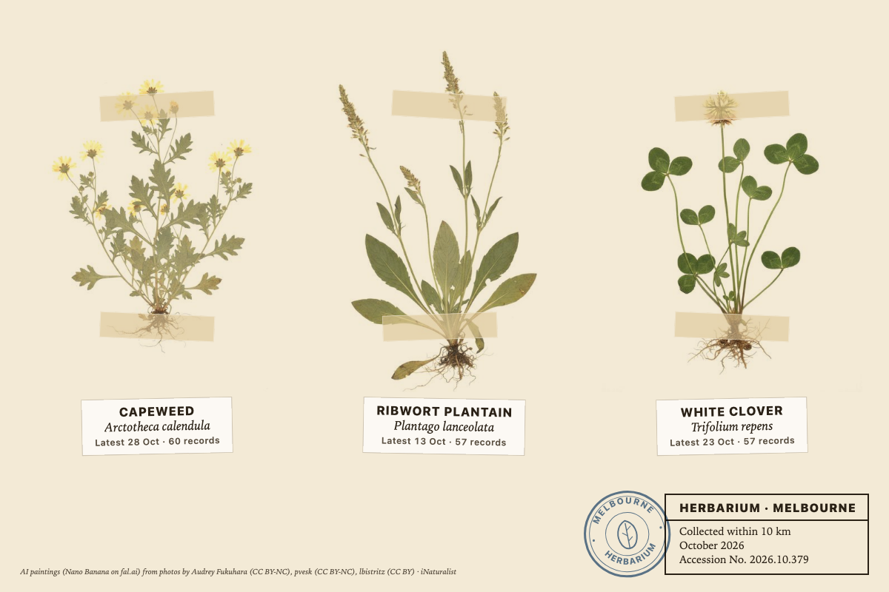
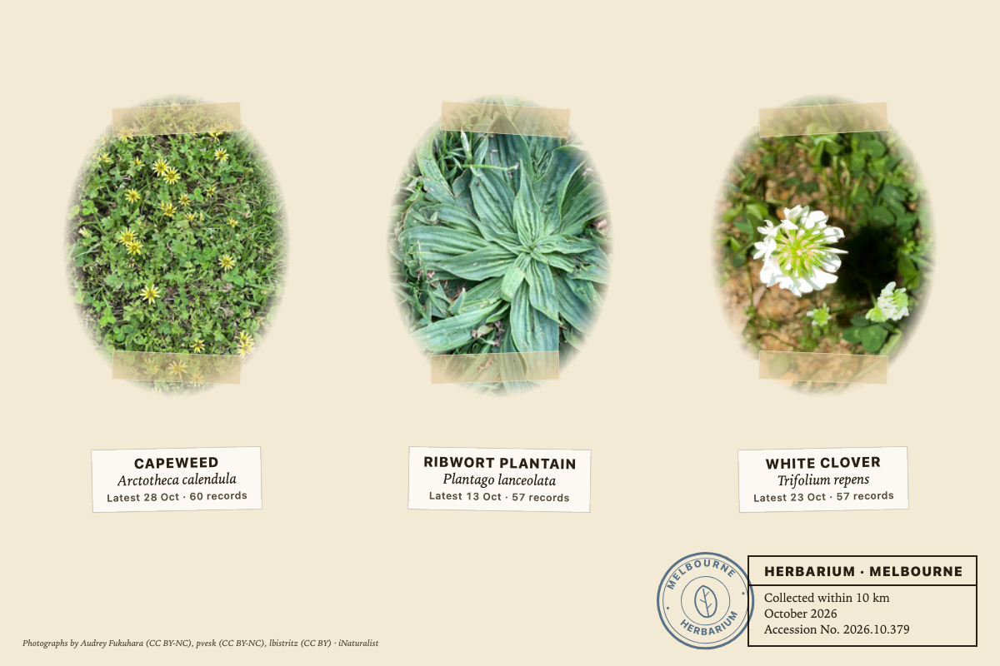
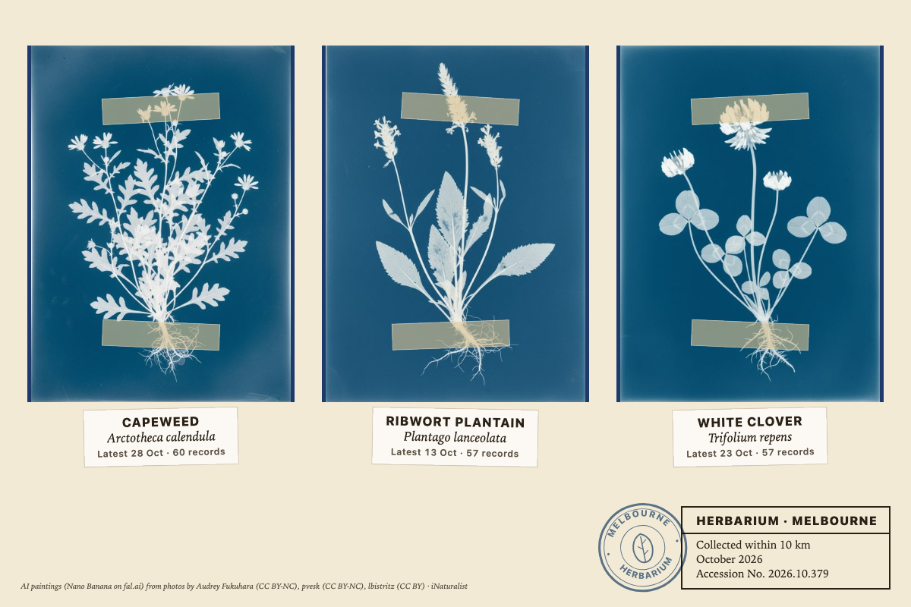
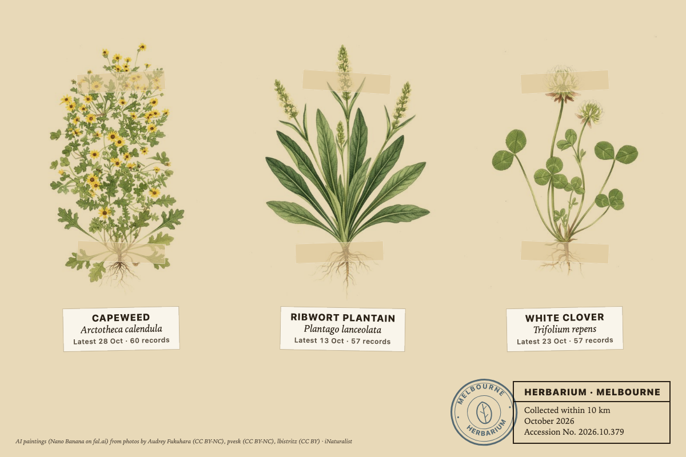
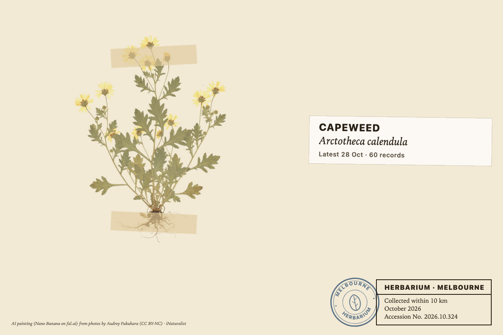
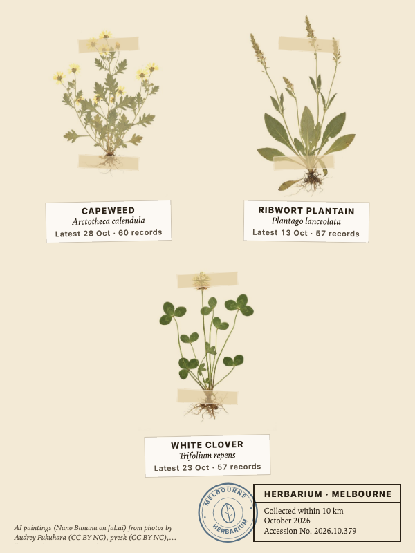
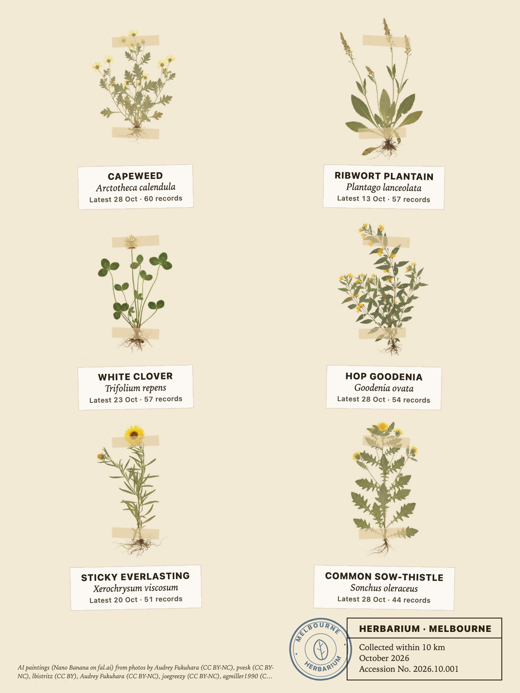
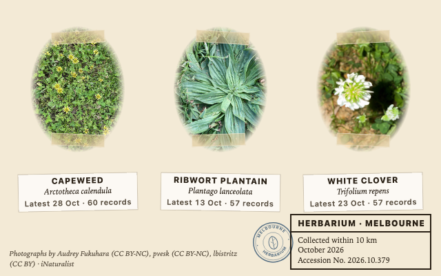
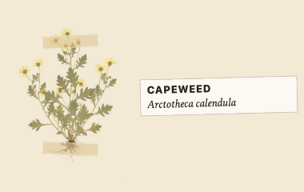
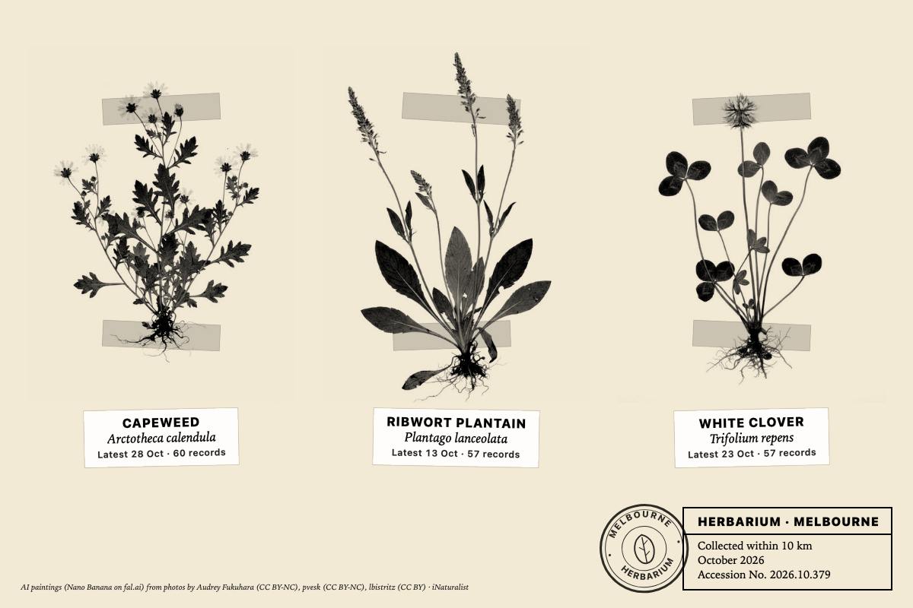

# herbarium_sheet

The plants in flower or fruit around the panel right now, as a herbarium
sheet: a few pressed specimens mounted on paper with strips of gummed tape, a
small label under each, a printed institutional label in the corner and a
stamp.

*The three most recorded plants within 10 km of Melbourne this month, as AI
paintings in the Pressed specimen style on cream paper (1200x800).*

## Where the data comes from

[iNaturalist](https://www.inaturalist.org): research-grade observations of
plants (`iconic_taxa=Plantae`) that carry a photo under a Creative Commons
licence, near a place or by one user. The widget asks for the species counts
in the window, takes the most recorded few, and for each fetches its newest
record with a licensed photo: that gives the date on the label, the
photograph, and the photographer and licence for the credit.

Three windows. **This month** is the current calendar month in any year, so
the sheet is seasonal: what people find flowering here at this time of year,
not news. **Last 30 days** and **Last 90 days** count back from to-day. The
species list is kept for six hours per cell; if iNaturalist cannot be reached
the last answer is shown, and with none the sheet shows an error card.

Limits worth knowing. "In flower" is a reading of the records, not a field on
them: a research-grade plant record in October is usually a plant worth
photographing in October, but a photo of bark or a seed head counts the same.
The ranking is by how many people recorded a species, so common weeds lead
in a city, which is honest about what is actually out there. Only
openly licensed photos are used, so a species whose photos are all rights
reserved is left off, and a photo is whatever the observer framed: a hand, a
label or a lawn may be in it.

The accession number is the year and month of the sheet and a number from the
cell's own settings, so a cell keeps its number through the month.

## Pictures

**Photographs** (the default, free): each species' iNaturalist photo in a
soft oval under the tape, credited at the foot.

*Photographs, the free default, on cream paper (1200x800).*

**AI paintings** (opt in, needs a fal.ai key): each species is painted once
per style from its own photo, through Tesserae's `app.artwork` (Tesserae
0.463 or later), which keeps the paintings, queues them, holds them while a
dashboard is being edited, budgets them and lists them on the widget's
paintings page under Plugins. The prompt asks for the whole plant pressed
flat, stems, leaves and flowers, the roots if the plant is small, on plain
white paper with nothing else: no label, no tape, no text, no shadow,
top-down. The painting's paper is then lifted to white and multiplied over
the page, so the plant sits on the sheet rather than in a rectangle. The
photograph shows until each painting lands, and the sheet asks the editors
to refresh while any is on the way. About US$0.04 a species with Nano Banana.
On an older Tesserae without `app.artwork` the photographs show and a note at
the foot says why.

Five styles: **Pressed specimen** (a real pressed and dried plant, muted
colours, flat), **Watercolour after Redouté**, **Ink and wash**, **Cyanotype
after Anna Atkins** (a white silhouette on Prussian blue paper; the picture
area goes blue), and **Woodcut herbal, 1542**.

*Cyanotype after Anna Atkins: the picture area is Prussian blue, the rest of
the page keeps its paper (1200x800).*

*Watercolour after Redouté on aged paper (1200x800).*

## Layouts

**Mounted** sets the specimens by how many: one centred and large, two side
by side, three in a row (two and one on a portrait cell), four in a row (a
two by two grid on portrait), six in a grid. Each has its label slip: the
common name, the Latin name in italics, the date of the latest record and
how many records. **Single plate** shows the most recorded species alone,
large, with the label block.

*Single plate, the first species alone (1200x800).*

*Three specimens on a portrait half panel: two and one (600x800).*

*Six specimens on a 13.3 inch portrait panel (1200x1600).*

A small cell shows one specimen and a two-line label, whatever is set; the
label block and the credits return at md.

*An md cell (640x400) with photographs, rendered on the dark theme: the paper
is the widget's own, so the theme does not change it.*

*An sm cell (380x240): one specimen and a two-line label.*

## Panels

**Panel** (More options) is what the panel can show: colour, 16 greys, 4
greys, or black and white. Paintings are converted and contrast-stretched to
match, photographs are shown in grey, and on black and white the type is
thickened and the tape and stamp go to ink.

*The Panel option set to black and white (1200x800).*

## Options

Source, window, layout, pictures and paper are always shown; the rest sit
under the choice they depend on or under **More options** (Tesserae 0.473 and
later; an older Tesserae shows them all).

| Option | Notes |
| --- | --- |
| Source | iNaturalist near a place, or one iNaturalist user's own plant observations. |
| iNaturalist username | With the user source. |
| Place | With the place source. Named on the label block and the stamp. Falls back to the app-level location. |
| Within | 2 to 50 km round the place. |
| Window | This month (seasonal, any year), last 30 days, last 90 days. |
| Layout | Mounted, or single plate. |
| How many | 1, 2, 3, 4 or 6 specimens, with Mounted. |
| Pictures | Photographs, or AI paintings. |
| Style | With AI paintings: pressed specimen, Redouté, ink and wash, cyanotype, woodcut herbal. |
| Paper | Cream, white or aged. |
| Model | More options, with AI paintings: Nano Banana (default), Nano Banana Pro, FLUX.1 Kontext Pro, GPT Image 2, Seedream 4. Each keeps its own paintings. |
| Panel | More options. Colour, 16 greys, 4 greys, black and white. |
| Title | More options. The first word on the label block; blank is HERBARIUM. |
| Credits at the foot | More options. Off hides the photographer and painter line. |

Widget settings: the fal.ai key (also found under the app's Settings, or
`FAL_KEY` in the environment), the painting budget per day (US$2 by default,
about fifty Nano Banana paintings), and how many new paintings one settled
preview may start.

## Network

The manifest declares `network:*` because the photographs come from
iNaturalist's media hosts and the paintings from fal.ai's, and both vary.
What the widget reaches: `api.inaturalist.org`;
`inaturalist-open-data.s3.amazonaws.com` and `static.inaturalist.org` for the
photos (fetched by the render browser, so the panel's Tesserae needs the
network at render time); and `fal.run` plus `fal.media` only with a key.

## Files

Under the widget's data folder: `cache/` (the species list per cell, kept six
hours) and `specimens/` (the paintings with their credits, a whitened copy of
each, resized copies, the day's spend and the queue), all managed by
`app.artwork`.

## Licence

AGPL-3.0. See [LICENSE](LICENSE). Observation data and photographs are
iNaturalist's observers' own, under the Creative Commons licence each chose
(CC0, CC BY, CC BY-NC, CC BY-SA, CC BY-NC-SA, CC BY-ND or CC BY-NC-ND), and
are credited on the sheet by name and licence; a painting made from a photo
is a derivative of it, and the credit says so. The paintings in the
screenshots were made with Nano Banana on fal.ai from photographs by Audrey
Fukuhara (CC BY-NC), pvesk (CC BY-NC), lbistritz (CC BY), joegreezy (CC
BY-NC) and agmiller1990 (CC BY-NC).
